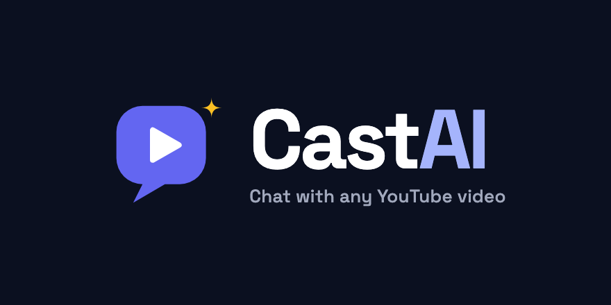

<p align="center">
  
</p>

<p align="center">
  <strong>Paste a YouTube link, then ask it questions.</strong><br />
  CastAI transcribes videos, extracts insights, and answers questions with citations that jump to the exact moment in the video.
</p>

<p align="center">
  <a href="#">Live demo</a> ·
  <a href="#features">Features</a> ·
  <a href="#how-it-works">How it works</a> ·
  <a href="#running-locally">Run locally</a>
</p>

<!-- TODO: add a screenshot or GIF of the dashboard + chat here -->

## Features

- **One-click ingest:** paste any YouTube URL. CastAI fetches the title, channel, thumbnail and full timestamped transcript.
- **AI insights:** every video gets a summary, speakers, key claims, top quotes and topics.
- **Semantic search (RAG):** transcripts are split into chunks, embedded, and stored in Postgres with pgvector. Questions match on meaning, not just keywords.
- **Streaming chat with citations:** answers stream in token by token over Server-Sent Events. Each answer cites the source chunk, and clicking a citation seeks the embedded player to that second.
- **Collections:** group videos and scope chat to one collection, a few selected videos, or your whole library.
- **Searchable transcript:** a timestamped transcript view where you can click any line to jump to it.
- **Email digest:** when a video finishes processing, you get an email with its summary.
- **Auth and data isolation:** Clerk handles authentication, and every API route checks that the caller owns the data.
- **Responsive:** a sidebar layout on desktop and a bottom tab bar on mobile.

## Tech stack

| Layer | Tools |
| --- | --- |
| Frontend | React 19, TypeScript, Vite, Tailwind CSS v4, Redux Toolkit, React Router |
| Backend | Vercel Serverless Functions (Node.js, TypeScript) |
| Database | Neon Postgres + pgvector, Drizzle ORM |
| AI | Gemini `gemini-embedding-001` (768-dim embeddings), Groq `llama-3.1-8b-instant` (chat + insight extraction) |
| Integrations | Clerk (auth + webhooks), Supadata (transcripts), YouTube Data API (metadata), Resend (email) |

## How it works

```
                 ┌──────────── Ingest (api/videos/ingest.ts) ─────────────┐
YouTube URL ──▶  │ metadata (YouTube API) + transcript (Supadata)         │
                 │   → split into time-aligned chunks                     │
                 │   → embed each chunk (Gemini, 768 dims)                │
                 │   → store chunks + vectors in Postgres (pgvector)      │
                 │   → extract insights (Groq) → email digest (Resend)    │
                 └────────────────────────────────────────────────────────┘

                 ┌──────────── Chat (api/chat.ts) ────────────────────────┐
Question ──────▶ │ resolve videos the user owns (selection / collection)  │
                 │   → embed question → match_chunks() vector search      │
                 │   → build prompt from top chunks + video insights      │
                 │   → stream answer from Groq via SSE, with citations    │
                 └────────────────────────────────────────────────────────┘
```

### Project structure

```
api/                  Vercel serverless functions
  _lib/               shared DB client + Clerk auth helper
  videos/             list, ingest, get transcript, re-extract insights, update collections
  collections/        CRUD for collections
  chat.ts             RAG chat endpoint (streams SSE)
  webhooks/clerk.ts   syncs Clerk users into Postgres
src/
  pages/              Landing page + dashboard (Library, VideoDetail, Chat)
  components/         Video cards, YouTube player, chat messages, collections panel
  store/              Redux Toolkit slices (videos, collections, chat, player)
  db/schema.ts        Drizzle schema
```

## Running locally

### Prerequisites

- Node.js 22+
- A [Neon](https://neon.tech) Postgres database with the `vector` extension enabled
- API keys for Clerk, Google AI Studio (Gemini), Groq, Supadata, YouTube Data API v3 and Resend
- The [Vercel CLI](https://vercel.com/docs/cli) (`npm i -g vercel`). `vercel dev` runs the frontend and the `api/` functions together.

### 1. Install

```bash
git clone https://github.com/Bits27/CastAI.git
cd CastAI
npm install
```

### 2. Environment variables

Create `.env.local` in the project root:

```bash
# Clerk
VITE_CLERK_PUBLISHABLE_KEY=
CLERK_SECRET_KEY=
CLERK_WEBHOOK_SECRET=

# Neon Postgres
DATABASE_URL=            # pooled connection string
DATABASE_URL_UNPOOLED=   # direct connection, used by drizzle-kit

# AI + integrations
GOOGLE_AI_API_KEY=
GROQ_API_KEY=
SUPADATA_API_KEY=
YOUTUBE_API_KEY=
RESEND_API_KEY=
```

### 3. Database

Push the schema with Drizzle:

```bash
npm run db:push
```

The vector column and the search function live outside the Drizzle schema. Run this once in the Neon SQL editor:

```sql
CREATE EXTENSION IF NOT EXISTS vector;
ALTER TABLE chunks ADD COLUMN IF NOT EXISTS embedding vector(768);

CREATE OR REPLACE FUNCTION match_chunks(
  query_embedding vector(768),
  match_count int,
  video_ids uuid[]
)
RETURNS TABLE (
  id uuid,
  video_id uuid,
  content text,
  start_time_seconds double precision,
  end_time_seconds double precision,
  similarity double precision
)
LANGUAGE sql STABLE AS $$
  SELECT c.id, c.video_id, c.content, c.start_time_seconds, c.end_time_seconds,
         1 - (c.embedding <=> query_embedding) AS similarity
  FROM chunks c
  WHERE c.video_id = ANY(video_ids)
  ORDER BY c.embedding <=> query_embedding
  LIMIT match_count;
$$;
```

### 4. Run

```bash
vercel dev
```

Then open http://localhost:3000.

### Scripts

| Command | Description |
| --- | --- |
| `npm run dev` | Vite dev server (frontend only) |
| `npm run build` | Type-check and build for production |
| `npm run lint` | ESLint |
| `npm run db:push` | Push the Drizzle schema to the database |
| `npm run db:generate` / `db:migrate` | Generate / apply SQL migrations |

## Deployment

The app deploys to Vercel with no extra configuration. `vercel.json` sends `/api/*` to the serverless functions and everything else to the SPA, and it gives the ingest function a 300-second timeout for long videos. Add the environment variables above to the Vercel project. Then point a Clerk webhook (`user.created`) at `/api/webhooks/clerk`.
